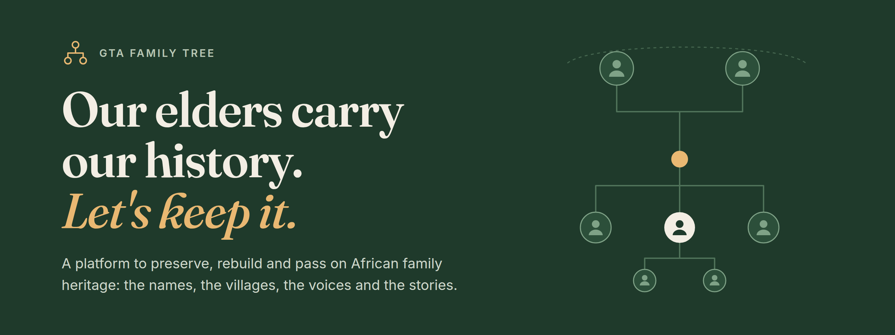
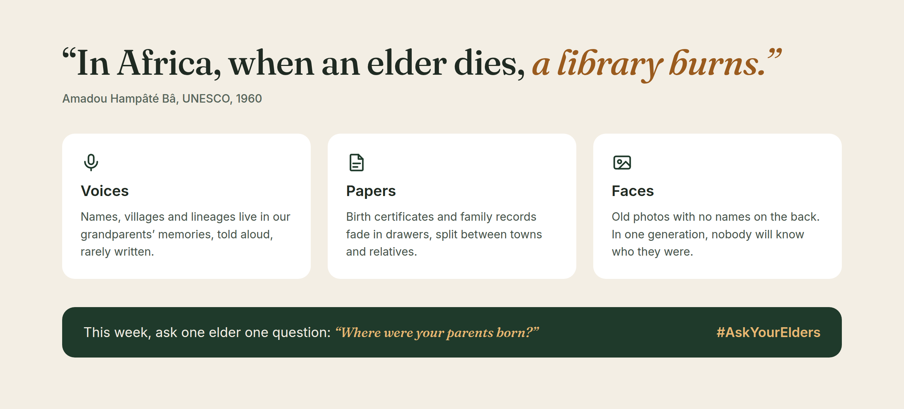
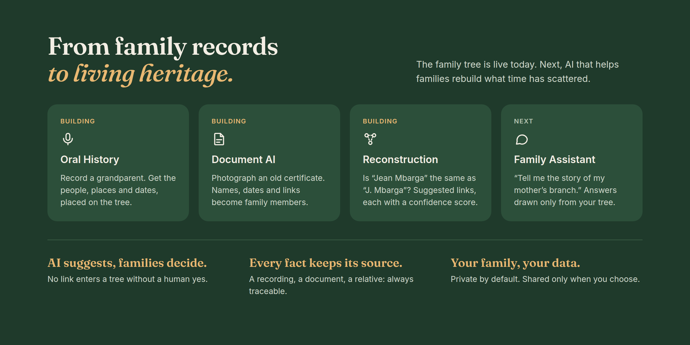
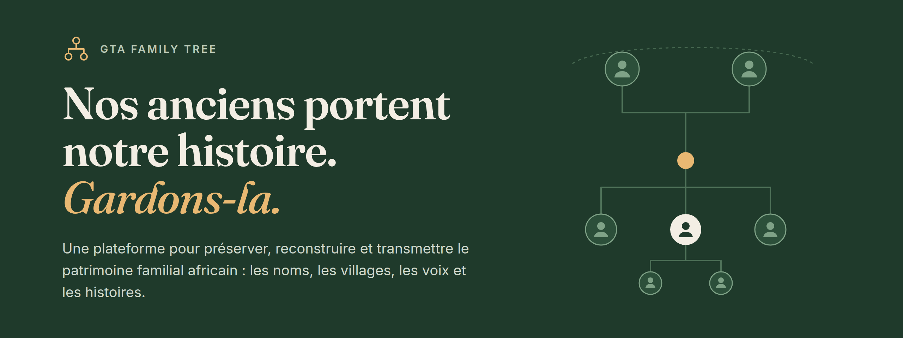
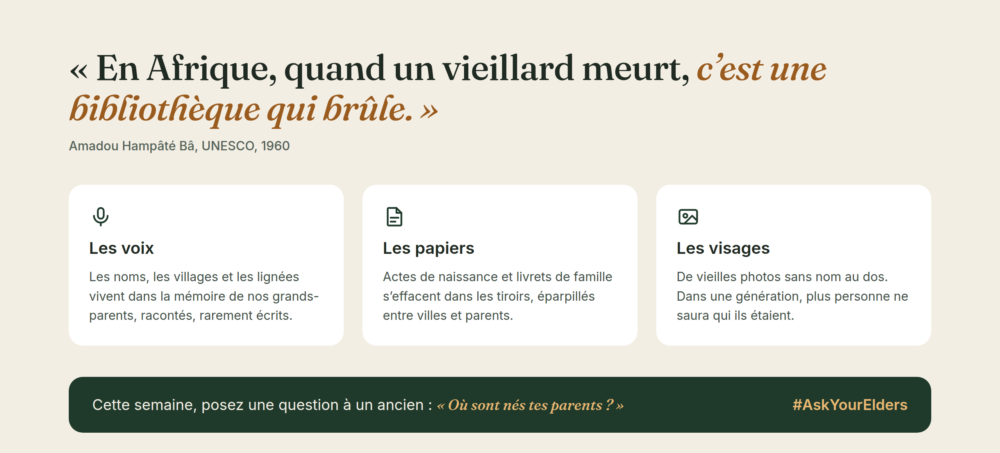
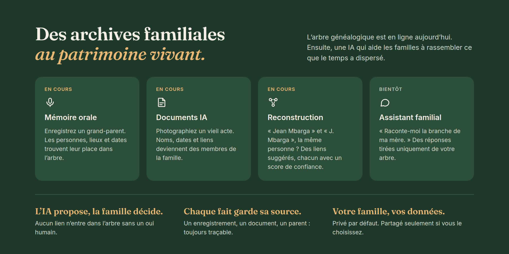
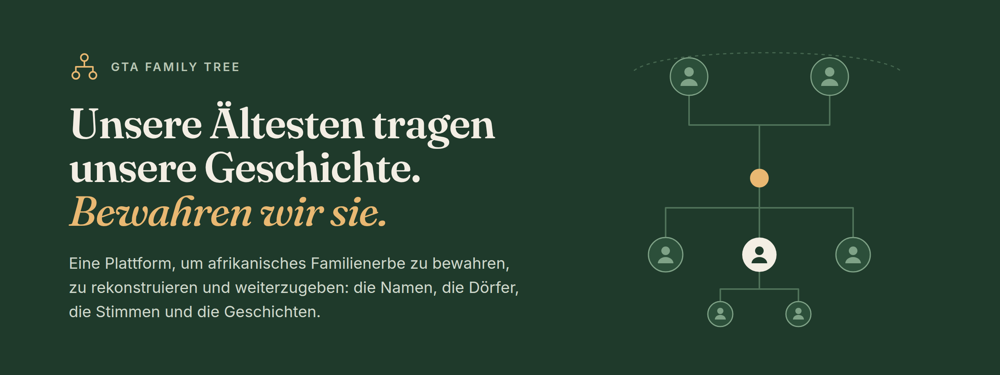
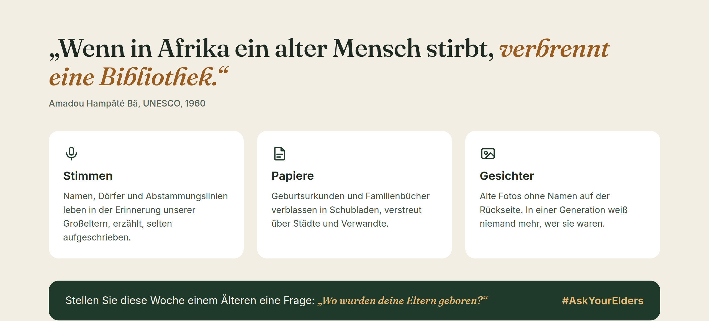
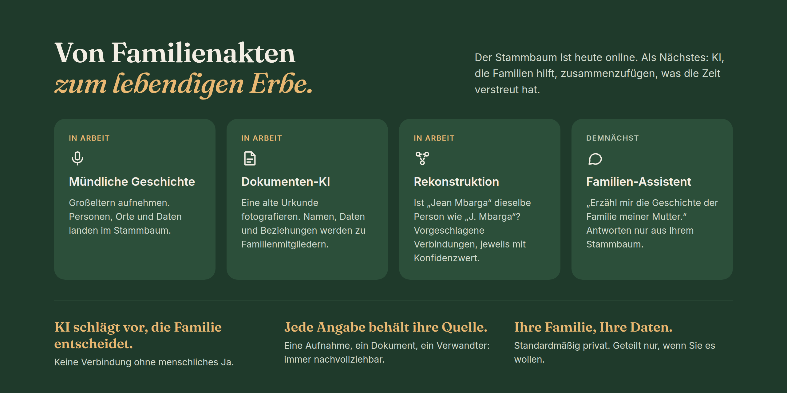

  <b>English</b> · <a href="#francais">Français</a> · <a href="#deutsch">Deutsch</a>

<h3 align="center">Start your tree today at <a href="https://familytree.gta-it.com">familytree.gta-it.com</a></h3>

  Then ask an elder one question, and share their answer with <b>#AskYourElders</b>. 
  Every name you save is a page that will not burn.

---

<h2 id="francais">Français</h2>

<b>Lire en français</b>

 

<h3 align="center">Commencez votre arbre sur <a href="https://familytree.gta-it.com">familytree.gta-it.com</a></h3>

  Puis posez une question à un ancien, et partagez sa réponse avec <b>#AskYourElders</b>. 
  Chaque nom enregistré est une page qui ne brûlera pas.

<h2 id="deutsch">Deutsch</h2>

<b>Auf Deutsch lesen</b>

 

<h3 align="center">Beginnen Sie Ihren Stammbaum auf <a href="https://familytree.gta-it.com">familytree.gta-it.com</a></h3>

  Stellen Sie dann einem Älteren eine Frage und teilen Sie die Antwort mit <b>#AskYourElders</b>. 
  Jeder gespeicherte Name ist eine Seite, die nicht verbrennt.

---

Made in Cameroon by <a href="https://gta-it.com">GTA</a>

